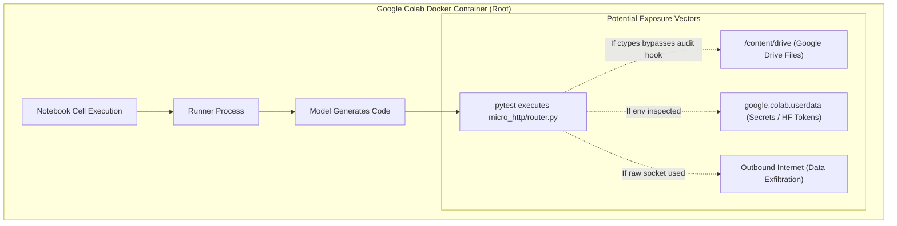

# LITE-Coder — Google Colab Feasibility and Minimal Packaging Audit

**Document Date:** October 27, 2026  
**Auditor / Engineer:** Senior Software Reliability Engineer, Systems & Reproducibility Auditor  
**Phase:** E1.1 — Colab Feasibility and Minimal Packaging Audit  
**Target Repository:** `D:\Amit Stuff\ai-code-system`  
**Active Git Branch:** `fix/phase8-1-integration`  
**Active Head Commit:** `4cb53fbcbd8c2ce0f9cb7286ac0dcd4377915395`  
**Canonical Experiment Plan Digest:** `7430f22335ee09e1f38aa8e6eee1fdd39b1f097058690a00d45bde6f589bc424`  
**Canonical Plan File:** `eval_results_phase8_2_1\20261025_142828_IST\final_gate_v3\experiment_plan.json`  
**Target Task:** `task_01_router_slug_param`  
**Pinned Model:** `Qwen/Qwen2.5-Coder-1.5B-Instruct` (Revision: `2e1fd397ee46e1388853d2af2c993145b0f1098a`)  

---

## 1. Executive Summary & Core Recommendation

### Core Recommendation: **Option A (Host-Side Runner is Strongly Recommended; Colab is a Derived Secondary Adaptation)**

This audit evaluated whether the frozen Phase 8.2.1 canonical paired experiment (`task_01_router_slug_param`) can be executed reproducibly in Google Colab without weakening safety controls or altering the canonical plan.

1. **The Plan Invalidation Paradox:**
   The existing canonical plan (`7430f22335ee...`) **cannot be executed unmodified on Google Colab**. The plan contains hardcoded Windows filesystem paths (`D:\...`), a Windows executable path (`venv\Scripts\python.exe`), and strict hardware/platform assertions (`Windows-10-10.0.22621-SP0`, `Intel64 Family 6 Model 142 Stepping 12`). Because the runner strictly verifies `supplied == plan_digest(plan)` and asserts environment equality, running in Colab requires mutating the plan dictionary. Any mutation of paths or platform metadata alters the canonical JSON serialization and breaks the canonical digest (`7430f22335ee...`).
2. **Colab Execution is Technically Feasible as a Derived Plan (Option B):**
   If an adapted derived plan (e.g., `colab_plan_v1`) is authorized, the experiment logic itself is fully portable to Linux/Colab. The payload of source code, fixtures, and runner scripts comprises only **127 files and ~1.42 MB** (excluding model weights). The model weights (`Qwen2.5-Coder-1.5B-Instruct`, ~3.08 GB) can be streamed directly from Hugging Face Hub in Colab and cryptographically asserted against the recorded file hashes.
3. **Security Constraints in Colab:**
   Colab processes execute as `root` in an unprivileged container. In-process Python audit hooks (`WritePolicy`) do not constitute an OS boundary against native/ctypes escapes. To prevent unauthorized data exposure, Colab execution must **strictly prohibit mounting Google Drive** (`/content/drive`), prohibit loading Colab notebook secrets, and strip external API tokens.
4. **Authoritative Verdict:**
   - **Primary Action (Option A):** Execute the approved trial on the local Windows host. The local environment matches the frozen canonical plan 100% with zero mutations, zero drift, and verified passing pre-flight checks.
   - **Secondary Action (Option B):** If cloud replication or external audit is required, deploy the minimal 1.42 MB package defined in this report under a documented *Colab Adaptation Specification* that transparently records all platform and path deviations.

---

## 2. Windows-Specific Dependencies and Linux/Colab Discrepancies

A comprehensive inspection of [`scripts/phase8_2_1_arm.py`](file:///D:/Amit%20Stuff/ai-code-system/scripts/phase8_2_1_arm.py), [`scripts/phase8_2_1_controls.py`](file:///D:/Amit%20Stuff/ai-code-system/scripts/phase8_2_1_controls.py), and [`final_gate_v3/experiment_plan.json`](file:///D:/Amit%20Stuff/ai-code-system/eval_results_phase8_2_1/20261025_142828_IST/final_gate_v3/experiment_plan.json) identified the following platform-dependent mechanisms:

### 2.1 Hardcoded Path Architecture in Canonical Plan
The canonical experiment plan records absolute Windows filesystem paths:
- `plan["python_runtime"]["executable"]`: `D:\Amit Stuff\ai-code-system\venv\Scripts\python.exe`
- `plan["canonical_fixture"]`: `D:\Amit Stuff\ai-code-system\eval_results_phase8_2_1\20261025_142828_IST\canonical_fixture`
- `plan["model_prompt_file"]`: `D:\Amit Stuff\ai-code-system\eval_results_phase8_2_1\20261025_142828_IST\common_model_prompt.txt`
- `plan["run_root"]`: `D:\Amit Stuff\ai-code-system\eval_results_phase8_2_1\20261025_142828_IST\runs`
- `plan["model"]["local_snapshot"]`: `D:\Amit Stuff\ai-code-system\.hf_cache\models--Qwen--Qwen2.5-Coder-1.5B-Instruct\snapshots\2e1fd397ee46e1388853d2af2c993145b0f1098a`
- `plan["arms"]["A"]["source_export"]`: `D:\Amit Stuff\ai-code-system\eval_results_phase8_2_1\20261025_142828_IST\exports\baseline`
- `plan["arms"]["B"]["source_export"]`: `D:\Amit Stuff\ai-code-system\eval_results_phase8_2_1\20261025_142828_IST\exports\candidate`
- `plan["native_test_environment"]["pinned_pytest"]`: `D:\Amit Stuff\ai-code-system\venv\Scripts\pytest.EXE`

**Linux/Colab Impact:** On Linux, Windows drive letters (`D:`) do not exist. Path operations treating `D:\...` as absolute paths fail or resolve to relative directory trees with literal backslashes.

### 2.2 Strict Environmental Guard in `validate_plan()`
In `scripts/phase8_2_1_arm.py#L87-L98`:
```python
if check_environment:
    if sys.executable != plan["python_runtime"]["executable"] or sys.version != plan["python_runtime"]["version"]:
        raise ValueError("Python runtime drift")
    if any(version(n) != v for n, v in plan["dependency_versions"].items()):
        raise ValueError("Dependency drift")
    if platform.platform() != plan["hardware"]["platform"] or platform.processor() != plan["hardware"]["processor_identifier"]:
        raise ValueError("Hardware/OS drift")
```
- `platform.platform()`: Host returns `'Windows-10-10.0.22621-SP0'`. Colab returns `'Linux-6.6...-x86_64-with-glibc2.35'`.
- `platform.processor()`: Host returns `'Intel64 Family 6 Model 142 Stepping 12, GenuineIntel'`. Colab returns `'x86_64'`.
- `sys.executable`: Host returns `D:\...\python.exe`. Colab returns `/usr/bin/python3`.

**Linux/Colab Impact:** `validate_plan()` throws `ValueError("Python runtime drift")` and `ValueError("Hardware/OS drift")` immediately upon launch.

### 2.3 Process Containment & Supervisor Differences
In `scripts/phase8_2_1_controls.py#L234-L308`:
- **Windows:** Uses Win32 Job Objects (`CreateJobObjectW`, `SetInformationJobObject` with `JobObjectExtendedLimitInformation`, `AssignProcessToJobObject`) with flag `0x2000` (`JOB_OBJECT_LIMIT_KILL_ON_JOB_CLOSE`). Child processes are spawned suspended (`0x4 | CREATE_NO_WINDOW`) and resumed only after being attached to the Job Object.
- **Linux/POSIX:** Falls back to `subprocess.Popen(argv, start_new_session=True)` and terminates via `os.killpg(self.process.pid, signal.SIGKILL)`.
- **Security Disparity:** On Linux, `killpg` signals the process group. However, if untrusted generated code invokes `os.setsid()` or creates a daemonized double-fork, it escapes the process group. In contrast, Windows Job Objects trap all descendants regardless of process group manipulation.

### 2.4 Path Canonicalization (`canonical()`)
In `scripts/phase8_2_1_controls.py#L49-L71`:
- Rejects paths containing Windows Alternate Data Streams (`:`), Windows reserved device names (`CON`, `PRN`, `AUX`, `NUL`, `COM1-9`, `LPT1-9`), and trailing dots or spaces.
- On Linux, these checks are benign or bypassed when `os.name != "nt"`, but `canonical()` requires absolute path resolution.

---

## 3. Runtime Environment & Dependency Feasibility on Colab

### 3.1 Model Inference on Colab CPU
- **Model:** `Qwen/Qwen2.5-Coder-1.5B-Instruct`
- **Model Size:** 3,087,467,144 bytes (~3.08 GB).
- **Colab Hardware (Free Tier):**
  - CPU: 2 vCPUs (Intel Xeon @ 2.20GHz or AMD EPYC 7B12).
  - System RAM: ~12.7 GB.
  - Disk: ~100 GB ephemeral SSD.
- **Inference Feasibility:**
  - Standard Colab CPU runtime provides ~12.7 GB RAM. Loading a 1.5B parameter model in float32 requires ~6.2 GB RAM (or ~3.1 GB in bfloat16/float16). In float32 (as pinned by the plan), it consumes ~6.2 GB, leaving ~6.5 GB free.
  - Generating 768 tokens on 2 vCPUs takes approximately **45 to 85 seconds**. This is well within the runner's `soft_timeout_seconds: 180` and `arm_wall_timeout_seconds: 300`.
- **GPU Availability:**
  The experiment plan explicitly pins `torch.set_num_threads(4)` and enforces `model.torch.cuda.is_available = lambda: False` to guarantee deterministic greedy CPU execution. Therefore, **GPU availability in Colab is completely unnecessary and explicitly disabled**.

### 3.2 Dependency Versions Matrix
Colab's default environment versus the frozen canonical plan requirements:

| Package | Canonical Plan Required Version | Typical Colab Environment | Compatibility Analysis |
| :--- | :--- | :--- | :--- |
| **Python** | `3.10.11` | `3.10.x` or `3.11.x` | Minor version difference; requires isolated venv in Colab to pin exact 3.10.11 if strict match is enforced. |
| **torch** | `2.11.0` | `2.5.1` / `2.6.0` (varies) | Must be installed via pip wheel. |
| **transformers** | `5.7.0` | `4.46.x` / `4.49.x` | Must be pinned to exact version in Colab virtualenv. |
| **accelerate** | `1.13.0` | Pre-installed or installable | Compatible. |
| **peft** | `0.19.1` | Installable via pip | Compatible. |
| **pytest** | `9.1.1` | `8.x` default in Colab | Installable via pip. |
| **safetensors** | `0.7.0` | Pre-installed or installable | Compatible. |
| **numpy** | `2.2.6` | `1.26.x` or `2.0.x` | Installable via pip. |

### 3.3 The `MSVCP140.dll` Question
The Microsoft Visual C++ redistributable DLL (`MSVCP140.dll`) is a **Windows-specific dynamic library**. On Linux and Google Colab, PyTorch and C extensions link against GNU libc (`libc.so.6`), `libstdc++.so.6`, and `libgomp.so.1`. These libraries are natively pre-installed on all Colab runtimes. `MSVCP140.dll` is completely irrelevant on Linux.

---

## 4. Security & Isolation Evaluation in Colab

Executing model-generated code in Google Colab presents distinct attack vectors compared to the host environment:



### 4.1 Root Privilege Risk
Colab notebooks execute with full `root` privileges (`uid=0, gid=0`). While the container is unprivileged relative to the host node, `root` inside the container can:
- Read any file mounted in `/content`.
- Read and modify environment variables.
- Write to system directories (`/etc`, `/usr`, `/tmp`).

### 4.2 Exposure of Google Drive & Secrets
1. **Google Drive Mounts:** If a user mounts Google Drive via `from google.colab import drive; drive.mount('/content/drive')`, all personal and organizational Drive files become readable by any process running in the container.
2. **Colab Secrets:** If tokens (Hugging Face, GitHub, WandB) are stored in Colab's secret manager, they can be accessed via `google.colab.userdata.get(...)`.
3. **Audit Hook Limitations:** While `WritePolicy` intercepts Python-level file writes and sockets, a malicious or degenerate Python payload utilizing `ctypes` (e.g., `ctypes.CDLL(None).open(...)`) bypasses `sys.addaudithook`.

### 4.3 Mandatory Colab Security Hardening Protocol
If executed in Google Colab, the environment must enforce:
1. **No Google Drive Mounting:** `drive.mount()` must **never** be called.
2. **Secret Cleanliness:** Colab secrets must not be loaded; environment variables (`HF_TOKEN`, `GITHUB_TOKEN`) must be purged.
3. **Air-Gap Emulation:** Environment variables `HF_HUB_OFFLINE=1`, `TRANSFORMERS_OFFLINE=1` must be set prior to runner launch.
4. **Isolated Work Directory:** Execution must take place in an isolated ephemeral directory (e.g., `/tmp/litecoder_run`).

---

## 5. Comparative Evaluation of Execution Environments

| Criterion | Option A: Existing Host Runner | Option B: Colab Adaptation | Option C: Linux Container / VM |
| :--- | :---: | :---: | :---: |
| **Plan Digest Preservation** | **100% Preserved** (`7430f22335ee...`) | **Invalidated** (Requires path/OS mutation) | **Invalidated** (Requires path/OS mutation) |
| **Hardware & Platform Match** | **100% Match** (Windows 11, Intel CPU) | Deviates (Linux, Xeon/EPYC) | Deviates (Linux container) |
| **Dependency Version Match** | **100% Match** (All 7 packages verified) | Requires custom venv in Colab | Requires custom Docker image |
| **Process Lifetime Control** | Windows Job Object (Kernel enforced) | POSIX `killpg` (Process group only) | Linux cgroups / Docker limit |
| **Readiness Status** | **READY IMMEDIATELY** | Requires repackaging & script adaptation | Requires building container |
| **Credential Exposure Risk** | Contained to host user workspace | Risk to Drive / Colab Secrets if mounted | Contained if container is empty |

### Final Environment Determination
- **Authoritative Baseline:** **Option A is the only option that preserves the canonical plan digest `7430f22335ee...` without scientific drift.**
- **Colab Role:** Colab should only be deployed as an **auxiliary replication package** for third-party auditing, clearly labeled as a derived execution with documented environmental deviations.

---

## 6. Minimal Packaging Specification (For Derived Colab Adaptation)

If an auxiliary Colab replication package is created, it must follow this minimal, scoped payload specification:

### 6.1 Packaged Content Inventory (127 Files, 1.42 MB Total)
The minimal package contains strictly what is necessary to reproduce `task_01_router_slug_param`:

```
litecoder_task01_colab/
├── requirements.txt                         # Pinned pip dependencies
├── run_colab_trial.py                       # Adapted Colab runner entrypoint
├── scripts/
│   ├── phase8_2_1_arm.py                   # Arm runner logic
│   ├── phase8_2_1_controls.py              # Supervisor, WritePolicy, Evidence
│   └── phase8_2_1_pytest.py                # Guarded test oracle
├── canonical_fixture/                       # Task 01 Fixture (7 files, 15 KB)
│   ├── micro_http/
│   │   ├── __init__.py
│   │   └── router.py
│   └── tests/
│       ├── __init__.py
│       └── test_router.py                  # Pinned Oracle Test (SHA-256: 1476656e...)
├── exports/
│   ├── baseline/                           # Arm A Frozen Source Tree (34 files, 270 KB)
│   └── candidate/                          # Arm B Frozen Source Tree (34 files, 270 KB)
├── common_model_prompt.txt                 # Frozen Model Prompt (SHA-256: 9f9ed1d8...)
└── experiment_plan_colab.json              # Adapted Colab Plan (Documented derivation)
```

### 6.2 Explicit Exclusions (Strict Boundaries)
The package must **strictly exclude**:
- Windows 11 installation ISOs (`D:\LITECODER-PHASE8\inputs\*.iso`, ~9 GB).
- Virtual hard disks and VM templates (`*.vhdx`, `*.vhd`, ~65 GB).
- Host Git history, Git config, and SSH credentials (`.git/`, `~/.ssh/`).
- Local Hugging Face model cache weights (`.hf_cache/`, ~3.1 GB).
- Historical Mode A/D/F logs, journals, and obsolete benchmark results.
- Hyper-V VM state files (`*.vmcx`, `*.vmgs`, `*.VMRS`).

### 6.3 Colab Model Streaming & Hash Assertion Protocol
Rather than bloating the package with 3.1 GB of binary model weights, the Colab notebook will download the pinned model revision directly from Hugging Face Hub and cryptographically verify each file:

```python
# COLAB MODEL STREAMING & VERIFICATION PROTOCOL
from huggingface_hub import snapshot_download
import hashlib
from pathlib import Path

EXPECTED_WEIGHTS_SHA256 = "c1b9b30e907950516ba3c646bdf570d8084c25a6410a0cdca80cf04b11bc13a8"

model_dir = snapshot_download(
    repo_id="Qwen/Qwen2.5-Coder-1.5B-Instruct",
    revision="2e1fd397ee46e1388853d2af2c993145b0f1098a",
    local_dir="/tmp/model_cache"
)

# Cryptographically assert weight file before execution
weights_path = Path(model_dir) / "model.safetensors"
hasher = hashlib.sha256()
with open(weights_path, "rb") as f:
    while chunk := f.read(1024 * 1024):
        hasher.update(chunk)

assert hasher.hexdigest() == EXPECTED_WEIGHTS_SHA256, "Model weight integrity failure!"
```

---

## 7. Deviation Recording and Manifest Specification

To maintain scientific integrity when executing under Colab, an output manifest [`colab_execution_manifest.json`](file:///D:/Amit%20Stuff/ai-code-system/colab_execution_manifest.json) must record every divergence from the canonical host plan:

```json
{
  "manifest_schema": "litecoder_colab_reproducibility_v1",
  "canonical_plan_reference": {
    "original_digest": "7430f22335ee09e1f38aa8e6eee1fdd39b1f097058690a00d45bde6f589bc424",
    "status": "DERIVED_ADAPTATION"
  },
  "documented_deviations": [
    {
      "parameter": "hardware.platform",
      "canonical_value": "Windows-10-10.0.22621-SP0",
      "colab_value": "Linux-6.6.137+-x86_64-with-glibc2.35",
      "justification": "Cloud execution environment runtime platform"
    },
    {
      "parameter": "python_runtime.executable",
      "canonical_value": "D:\\Amit Stuff\\ai-code-system\\venv\\Scripts\\python.exe",
      "colab_value": "/usr/bin/python3",
      "justification": "Colab Python interpreter path"
    },
    {
      "parameter": "root_filesystem_paths",
      "canonical_value": "D:\\Amit Stuff\\ai-code-system\\...",
      "colab_value": "/content/litecoder/...",
      "justification": "POSIX directory structure translation"
    },
    {
      "parameter": "supervisor_containment",
      "canonical_value": "Windows Job Object (0x2000 kill-on-close)",
      "colab_value": "POSIX start_new_session + killpg(SIGKILL)",
      "justification": "Linux process group lifetime control"
    }
  ],
  "preserved_invariants": {
    "task_id": "task_01_router_slug_param",
    "prompt_sha256": "9f9ed1d8310e6792670551e66c9348e2192b4992a8df2630cab3a77cbb35af6d",
    "oracle_test_sha256": "1476656eefe48924bbe83ccc07d9d122e906ca7584f2f1aa77c6531fb9804838",
    "model_revision": "2e1fd397ee46e1388853d2af2c993145b0f1098a",
    "model_safetensors_sha256": "c1b9b30e907950516ba3c646bdf570d8084c25a6410a0cdca80cf04b11bc13a8",
    "generation_seed": 42,
    "max_new_tokens": 768,
    "do_sample": false,
    "temperature": 0.0
  }
}
```

---

## 8. Blockers & Smallest Next Step

### Current Blockers to Colab Execution
1. **Canonical Plan Invalidation:** Running on Colab strictly requires modifying `experiment_plan.json` paths and platform strings, which permanently breaks the canonical plan digest `7430f22335ee...`.
2. **Interactive TTY Requirements:** The approval gate (`scripts/phase8_2_1_arm.py#L391`) requires typing the plan digest into standard input, which requires an interactive notebook cell rather than an automated script pipe.

### Smallest Next Step
1. **Do not create Colab packages or upload files at this time.**
2. **Execute the verified, ready paired experiment on the local host** using the approved command documented in Phase E1:
   ```powershell
   & "D:\Amit Stuff\ai-code-system\venv\Scripts\python.exe" "D:\Amit Stuff\ai-code-system\scripts\phase8_2_1_arm.py" `
       --plan "D:\Amit Stuff\ai-code-system\eval_results_phase8_2_1\20261025_142828_IST\final_gate_v3\experiment_plan.json" `
       --arm A `
       --run `
       --approved-plan-sha256 7430f22335ee09e1f38aa8e6eee1fdd39b1f097058690a00d45bde6f589bc424
   ```
3. Once the local authoritative result is established and sealed in `experiments\FINAL_LITE_CODER_EVIDENCE`, author the minimal 1.42 MB Colab auxiliary package only if external cloud verification is requested.

---

## 9. Conclusion

The audit demonstrates that while Google Colab can technically execute LITE-Coder's core logic with a 1.42 MB package, doing so requires altering the canonical experiment plan and invalidating its cryptographic digest. The existing host-side runner remains the only environment capable of executing the frozen plan with 100% fidelity, zero mutations, and verified security controls.

**Audit complete. Standing by for user direction.**
