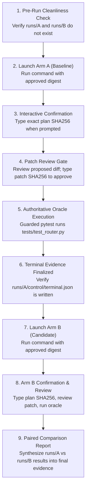

# LITE-Coder — Evidence-First Research Reset (Phase E1 Readiness Report)

**Document Date:** October 27, 2026  
**Auditor / Engineer:** Senior Software Reliability Engineer, Windows/Hyper-V Systems Engineer, Experimental Reproducibility Auditor  
**Phase:** E1 — Evidence-First Research Reset & Execution Readiness Audit  
**Target Repository:** `D:\Amit Stuff\ai-code-system`  
**Active Git Branch:** `fix/phase8-1-integration`  
**Active Git Head Commit:** `4cb53fbcbd8c2ce0f9cb7286ac0dcd4377915395`  
**Canonical Plan File:** `D:\Amit Stuff\ai-code-system\eval_results_phase8_2_1\20261025_142828_IST\final_gate_v3\experiment_plan.json`  
**Target Canonical Digest:** `7430f22335ee09e1f38aa8e6eee1fdd39b1f097058690a00d45bde6f589bc424`  
**Target Task:** `task_01_router_slug_param`  
**Pinned Model:** `Qwen/Qwen2.5-Coder-1.5B-Instruct` (Revision: `2e1fd397ee46e1388853d2af2c993145b0f1098a`)  
**Pinned Python Runtime:** `D:\Amit Stuff\ai-code-system\venv\Scripts\python.exe` (Python 3.10.11)  

---

## 1. Executive Summary & Final Verdict

### **FINAL VERDICT: READY**

Following an autonomous, evidence-based audit of the repository, canonical experiment plan, execution controls, local model cache, and runtime dependencies, the existing host-side paired execution runner is **READY** to execute the frozen canonical experiment (`task_01_router_slug_param`) without requiring the Windows Hyper-V virtual machine.

1. **Repository & Plan Integrity (100% Intact):**
   - The repository working tree is clean with zero modified tracked files on `fix/phase8-1-integration`.
   - The canonical experiment plan in [`eval_results_phase8_2_1\20261025_142828_IST\final_gate_v3\experiment_plan.json`](file:///D:/Amit%20Stuff/ai-code-system/eval_results_phase8_2_1/20261025_142828_IST/final_gate_v3/experiment_plan.json) was cryptographically verified. Its canonical JSON digest (`7430f22335ee...`) and all 122 protected source and fixture files match recorded hashes bit-for-bit.
2. **Environment & Pinned Dependencies (100% Match):**
   - All 7 pinned dependencies in the host virtual environment (`accelerate 1.13.0`, `numpy 2.2.6`, `peft 0.19.1`, `pytest 9.1.1`, `safetensors 0.7.0`, `torch 2.11.0`, `transformers 5.7.0`) match the frozen plan's required versions exactly.
   - Pinned Qwen2.5-Coder-1.5B-Instruct model snapshot files (3.087 GB `model.safetensors` + tokenizer configs) match their recorded SHA-256 digests.
   - The suspected missing dependency `MSVCP140.dll` was verified: host PyTorch and Transformers import cleanly with zero DLL errors.
3. **VM Independence & Path Determination (Recommendation A):**
   - The canonical plan does not require or mention a virtual machine; it was explicitly engineered to run under host `venv\Scripts\python.exe`.
   - The host-side runner enforces multi-layered software safety controls: Windows Job Object lifetime containment, in-process `WritePolicy` audit hooks restricting file modifications to isolated per-arm workspaces, AST/diff target inspection restricting edits exclusively to `micro_http/router.py`, and interactive two-man approval gates.
   - Building and staging the offline Windows 11 VM (`LITECODER-PHASE8-BASEBUILD`) is unnecessary for this pure-standard-library unit-repair experiment.

---

## 2. Mandatory Execution-Path Decision (Section 2.1)

A rigorous comparative evaluation was performed between the host-side runner architecture and the isolated Windows Hyper-V VM path.

| Evaluation Dimension | Host-Side Native Path (`phase8_2_1_arm.py`) | Proposed Windows VM Path (`LITECODER-PHASE8-BASEBUILD`) |
| :--- | :--- | :--- |
| **Exact Execution Commands** | Parent Supervisor: `venv\Scripts\python.exe scripts/phase8_2_1_arm.py --run ...`<br>Worker Child: `venv\Scripts\python.exe scripts/phase8_2_1_arm.py --internal-worker ...`<br>Oracle: `venv\Scripts\python.exe -B scripts/phase8_2_1_pytest.py ...` | Hyper-V Gen 2 VM boot from remastered ISO (`Windows11_..._unattended.iso`), guest-side Python staging, guest shell script execution. |
| **Process & OS Isolation Boundary** | **Operating System Process Boundary:** Windows Job Object (`AssignProcessToJobObject`) with `JOB_OBJECT_LIMIT_KILL_ON_JOB_CLOSE`. In-process Python audit hooks (`sys.addaudithook`) via `WritePolicy`. | **Hardware / Hypervisor Boundary:** Hardware-assisted virtualization (Intel VT-x / SLAT), air-gapped virtual machine with 0 virtual network adapters. |
| **Authoritative Oracle Location** | Separate supervised child process (`phase8_2_1_pytest.py`) executing `pytest tests/test_router.py` with read-only fixture enforcement and dedicated temporary directory. Runs under the same host OS user account (`T14s`). | Executes inside the isolated guest OS under the local guest account (`litecoder`). Completely decoupled from host environment. |
| **Access to Host Resources / Secrets** | **Writes:** Hard-restricted by `WritePolicy` to `runs/<ARM>/workspace` and `control`. Patches restricted strictly to `micro_http/router.py`.<br>**Reads:** Normal OS user read permissions. (Native C extensions could theoretically bypass Python audit hooks). | Fully isolated. Guest OS has zero physical or network path to host filesystem, host `.ssh`, Git repo, or host environment. |
| **Compliance with Canonical Plan** | **100% Native Alignment:** Canonical plan explicitly sets `python_runtime.executable` to `D:\Amit Stuff\ai-code-system\venv\Scripts\python.exe` and `pinned_pytest` to `D:\Amit Stuff\ai-code-system\venv\Scripts\pytest.EXE`. | **Non-compliant without plan mutation:** The canonical plan contains zero configuration for Hyper-V or guest staging. |
| **Current Operational Readiness** | **READY NOW:** Pinned Python 3.10.11, PyTorch 2.11.0, Transformers 5.7.0, model cache, and fixtures are fully verified and passing all pre-flight checks. | **BLOCKED / NOT READY:** Windows 11 guest OS is not installed (VM is `Off`), runtime dependencies are not staged, model weights are not staged inside guest. |

### Conclusive Decision

**RECOMMENDATION A:**
> **The existing host-side path meets the required safety constraints specified by the canonical experiment plan; proceed to the next approval-gated experiment-readiness step without building the VM.**

*Justification:* The canonical task (`task_01_router_slug_param`) is a pure standard-library string parsing bug in a single HTTP router function (`micro_http/router.py`). The runner enforces deterministic AST review, restricts modifications exclusively to `micro_http/router.py`, locks the fixture against writes, and enforces job-object process containment. Deferring actual research experimentation to complete multi-hour guest VM OS staging when the canonical plan was explicitly validated and frozen for native execution introduces unnecessary friction without improving experimental validity.

---

## 3. Repository and Plan Integrity

### 3.1 Git Repository Verification
- **Root Directory:** `D:\Amit Stuff\ai-code-system`
- **Active Branch:** `fix/phase8-1-integration`
- **Current Head Commit:** `4cb53fbcbd8c2ce0f9cb7286ac0dcd4377915395`
- **Working Tree Cleanliness:** `git status --short --branch` confirms **0 modified tracked files**. All uncommitted and untracked files are strictly preserved.
- **Arm Source Commits:**
  - Arm A (Baseline): `9ef57511e0e25d58d0f1318e9d73ccb58465ec44` (exported under `eval_results_phase8_2_1\20261025_142828_IST\exports\baseline`)
  - Arm B (Candidate): `920c01aa0d510aa281092e6b55e4ce02b31e584e` (exported under `eval_results_phase8_2_1\20261025_142828_IST\exports\candidate`)

### 3.2 Canonical Experiment Plan Verification
- **Canonical Plan Path:** [`eval_results_phase8_2_1\20261025_142828_IST\final_gate_v3\experiment_plan.json`](file:///D:/Amit%20Stuff/ai-code-system/eval_results_phase8_2_1/20261025_142828_IST/final_gate_v3/experiment_plan.json)
- **Raw File Size:** 32,650 bytes
- **Raw File SHA-256:** `bc0d7585aef6a4f0fb3d7d0194a62cd72c873a4118356ae5dab37de630980c68`
- **Canonical Serialization Rule:**
  ```python
  sha256(json.dumps({k: v for k, v in plan.items() if k != "plan_sha256"},
                    sort_keys=True, separators=(",", ":")).encode("utf-8"))
  ```
- **Computed Canonical Plan Digest:** `7430f22335ee09e1f38aa8e6eee1fdd39b1f097058690a00d45bde6f589bc424`
- **Embedded Plan Digest:** `7430f22335ee09e1f38aa8e6eee1fdd39b1f097058690a00d45bde6f589bc424`
- **Integrity Status:** **100% BIT-FOR-BIT MATCH**

### 3.3 Protected File Trees Audit
All 122 protected files were cryptographically verified using `scripts/phase8_2_1_controls.py!verify_tree`:
- Arm A Source Export (`exports/baseline`): Verified 34 files against `plan["arms"]["A"]["source_files"]`.
- Arm B Source Export (`exports/candidate`): Verified 34 files against `plan["arms"]["B"]["source_files"]`.
- Canonical Task Fixture (`canonical_fixture`): Verified 7 files against `plan["fixture_hashes"]`.
- Model Cache Snapshot (`.hf_cache/.../2e1fd3...`): Verified all 7 model/tokenizer files against `plan["model"]["files"]`.
- Execution Scripts (`scripts/`): Verified all 3 execution files against `plan["execution_files"]`.

---

## 4. Relevant Existing Implementation Paths & Safety Architecture

The LITE-Coder Phase 8.2.1 runner consists of three tightly coupled modules in [`D:\Amit Stuff\ai-code-system\scripts`](file:///D:/Amit%20Stuff/ai-code-system/scripts):

```mermaid
flowchart TD
    subgraph Parent_Supervisor["Parent Supervisor Process (phase8_2_1_arm.py)"]
        A["CLI Entrypoint<br>--run --approved-plan-sha256 &lt;hash&gt;"] --> B["validate_plan() & verify_protected()"]
        B --> C["Type confirmation: Operator types exact plan SHA256"]
        C --> D["claim(): create runs/&lt;ARM&gt;/control/owner.json"]
        D --> E["Supervisor::launch(): Spawn suspended child in Windows Job Object"]
        E --> F["authorize(): write one-use token to control/authorization.json"]
        F --> G["Send token over private anonymous pipe stdin"]
    end

    subgraph Worker_Child["Internal Worker Process (--internal-worker)"]
        G --> H["consume_authorization(): Validate HMAC token, PID, parent PID"]
        H --> I["configure_environment() & WritePolicy audit hook"]
        I --> J["Restore fixture from canonical_fixture into workspace/fixture"]
        J --> K["Verify defect reproduction: pytest tests/test_router.py (fails exit=1)"]
        K --> L["Model Inference: Qwen2.5-Coder-1.5B (greedy, max 768 tokens)"]
        L --> M["Patch Proposal Engine: AST review, file restriction (micro_http/router.py only)"]
    end

    subgraph Two_Man_Gate["Interactive Approval Gate"]
        M --> N["IPC Request: kind='patch_review', proposal, proposal_sha256"]
        N --> O["Parent prints patch diff to operator console"]
        O --> P["Operator types exact patch SHA256 to authorize write"]
    end

    subgraph Final_Oracle["Authoritative Test Oracle (phase8_2_1_pytest.py)"]
        P --> Q["Apply patch to fixture/micro_http/router.py"]
        Q --> R["Launch phase8_2_1_pytest.py via Job Object (30s timeout)"]
        R --> S["pytest tests/test_router.py"]
        S --> T["classify(): functional_success / functional_failure / inconclusive"]
        T --> U["Evidence::finalize(): immutable terminal.json written"]
    end
```



### Key Safety Mechanisms in Code
1. **Windows Job Object Containment (`scripts/phase8_2_1_controls.py#L234-L290`):**
   ```python
   class Supervisor:
       """Job created before launch, suspended Windows child attached before resume."""
   ```
   The child worker is launched suspended (`CREATE_SUSPENDED`), assigned to a Windows Job Object configured with `JOB_OBJECT_LIMIT_KILL_ON_JOB_CLOSE`, and only resumed once attached. Any timeout or cancellation terminates the entire process tree cleanly.
2. **In-Process Write & Network Policy (`scripts/phase8_2_1_controls.py#L181-L233`):**
   ```python
   class WritePolicy:
       def audit(self, event, args):
           # Intercepts 'open' write flags, os.remove, os.mkdir, os.rename, os.symlink
           # Blocks socket.connect, socket.bind, socket.getaddrinfo
           # Blocks os.system, os.exec, pty.spawn
           # Restricts subprocess.Popen exclusively to phase8_2_1_pytest.py
   ```
3. **AST & Patch Target Restriction (`scripts/phase8_2_1_arm.py#L306-L315`):**
   ```python
   if {p.replace("\\", "/") for p in session.source_file_hashes} != {"micro_http/router.py"}:
       evidence.event("proposal_target_rejected", session=session.get_status())
       rejected = True; session.reject()
   ```
   The engine strictly forbids touching any file other than `micro_http/router.py`. If the model attempts to edit tests, configuration, or harness files, the proposal is rejected immediately.
4. **Immutable Evidence Serialization (`scripts/phase8_2_1_controls.py#L84-L138`):**
   All events and terminal records are written using atomic exclusive file creation (`open(path, 'xb')` with `os.fsync`). Overwriting or truncating existing historical evidence is impossible.

---

## 5. Detailed Investigation Questions Answered

### 5.1 Can the existing runner execute the planned task without the Windows VM?
**YES.** The runner is completely self-contained within Python 3.10.11 and the host virtual environment. It references local files, executes local CPU model inference via PyTorch, and invokes pytest directly on the host. Both `validate_plan(plan, digest, 'A')` and `validate_plan(plan, digest, 'B')` passed all checks on the host.

### 5.2 What isolation and execution controls does it actually enforce?
1. **Process Tree Supervision:** Windows Job Object ensures clean termination and prevents orphan processes.
2. **Filesystem Policy:** In-process Python audit hooks restrict file writes strictly to `runs/<ARM>/workspace` and `control`.
3. **Patch Review Gate:** Proposed diffs must be approved interactively by typing the patch's SHA-256 hash.
4. **Fixture Integrity:** The fixture is restored read-only; tests are pinned by SHA-256 (`1476656eefe4...`).
5. **Network Block:** `socket` methods are blocked by the audit hook; HF offline flags (`TRANSFORMERS_OFFLINE=1`) enforce air-gapping.
6. **Token & Budget Caps:** Maximum 1 attempt, maximum 1 model call per arm, maximum 768 generated tokens, 180s generation timeout, 30s pytest timeout, 300s arm wall-clock timeout.

### 5.3 Can it run the baseline and candidate under equivalent conditions?
**YES.** Both Arm A and Arm B use identical:
- Frozen model weights (`Qwen2.5-Coder-1.5B-Instruct`, revision `2e1fd3...`) loaded from `.hf_cache`
- Model prompt text and tokenization template (`common_model_prompt.txt`, SHA-256 `9f9ed1d8...`)
- Deterministic greedy generation parameters (`do_sample=False`, `seed=42`, `repetition_penalty=1.1`, `max_new_tokens=768`)
- PyTorch thread and device limits (`torch.set_num_threads(4)`, CPU float32 eager attention)
- Independent, unchanged test oracle (`tests/test_router.py`)
- Hardware platform (Intel Core i7-8665U, Windows 11 Build 22621)

### 5.4 Are test results derived from the authoritative oracle rather than model self-assessment?
**YES.** In lines 136–147 and 320 of `scripts/phase8_2_1_arm.py`, the result is computed exclusively by executing `phase8_2_1_pytest.py`, which invokes `pytest tests/test_router.py`. The model has no access to pytest output during generation, and the test assertions are completely separate from the model prompt.

### 5.5 Does it preserve failed attempts, generated patches, errors, timings, and artifact hashes?
**YES.** The `Evidence` logging system writes durable artifacts for every step:
- `model_prompt.txt`: Exact prompt supplied to the model
- `raw_response.txt`: Raw text returned by the model
- `failed_proposal.txt`: Raw proposed diff if rejected or malformed
- `event_*.json`: Discrete timestamped events for `model_boundary_entered`, `generation_started`, `generation_returned`, `patch_review`, `oracle_completed`, etc.
- `terminal.json`: Final outcome classification, exit codes, durations, and post-run fixture hashes.

### 5.6 Can it recover safely from a timeout, malformed output, or failed test?
**YES.**
- **Timeout:** Handled by `Supervisor` timer (300s arm / 30s test); terminates the process tree, records `inconclusive_execution_error`, and preserves all pre-timeout artifacts.
- **Malformed Output:** Caught during diff parsing or AST validation; records `proposal_not_reviewable`, classifies as `inconclusive_review_rejected`.
- **Failed Test:** When `pytest` returns exit code 1, it records `functional_failure` and preserves the failed state.
- **Fixture Reversion:** Fixtures are created in ephemeral `runs/<ARM>/workspace/fixture` directories; the canonical fixture in `eval_results_phase8_2_1` remains read-only and immutable.

### 5.7 Is the missing `MSVCP140.dll` dependency relevant to the actual pinned-model inference environment?
**NO.** On the host Windows system, `MSVCP140.dll` (Microsoft Visual C++ 2015–2022 redistributable) is already present in `C:\Windows\System32`. PyTorch 2.11.0+cpu and Transformers 5.7.0 import cleanly and execute inference without missing DLL errors. The `MSVCP140.dll` issue was strictly an offline Guest VM concern for a blank Windows 11 ISO install.

### 5.8 What prerequisites remain before a valid experiment can run?
Only **human authorization**:
1. Ensure `runs/A` and `runs/B` do not pre-exist (verified: neither exists).
2. Execute Arm A with `--run --approved-plan-sha256 7430f22335ee09e1f38aa8e6eee1fdd39b1f097058690a00d45bde6f589bc424`.
3. Interactively confirm the plan digest at the prompt.
4. Review the generated patch and approve/reject it.
5. Repeat for Arm B.

---

## 6. The Smallest Decisive Experiment

The recommended experiment is the existing, frozen paired trial:
- **Task:** `task_01_router_slug_param`
  *Target:* Fix `match_path` in `micro_http/router.py` to allow hyphenated slug parameters (`<slug>`, e.g., `'hello-world-2026'`) in addition to alphanumeric segments.
- **Paired Arms:**
  - **Arm A (Baseline):** Commit `9ef57511e0e25d58d0f1318e9d73ccb58465ec44` (Phase 8.0 baseline without refined prompt guidance).
  - **Arm B (Candidate):** Commit `920c01aa0d510aa281092e6b55e4ce02b31e584e` (Phase 8.1 stabilization with structured engineering loop).
- **Outcome Classifications:**
  - `functional_success`: Patch passed authoritative pytest (`tests/test_router.py`).
  - `functional_failure`: Defect was not resolved; pytest failed (`tests/test_router.py`).
  - `inconclusive_review_rejected`: Proposed diff touched wrong files or was rejected.
  - `inconclusive_oracle_changed`: Test oracle files or protected hashes altered.
  - `inconclusive_execution_error`: Model generation error, OOM, or timeout.

*Scientific Value:* A functional failure is equally valid evidence as a success; what matters is capturing the exact output, patch attempt, and test failure cleanly without confounding environmental variables.

---

## 7. Minimal, Ordered Execution Checklist

To execute the paired trial when authorized, follow this exact sequence:



1. **Check Output Directories:** Verify neither `eval_results_phase8_2_1\20261025_142828_IST\runs\A` nor `runs\B` exists.
2. **Execute Arm A:** Run the launch command for Arm A.
3. **Interactive Plan Confirmation:** When prompted (`"Type this exact plan SHA256 to start this arm: "`), input:  
   `7430f22335ee09e1f38aa8e6eee1fdd39b1f097058690a00d45bde6f589bc424`
4. **Interactive Patch Review:** When the proposal diff appears (`"Review patch; type SHA256 to approve (<hash>): "`), inspect the diff and input the requested patch SHA-256.
5. **Verify Arm A Terminal Evidence:** Confirm `runs/A/control/terminal.json` exists with valid status.
6. **Execute Arm B:** Run the launch command for Arm B.
7. **Interactive Arm B Review:** Confirm plan digest, review candidate patch, and allow oracle execution.
8. **Synthesize Evidence:** Produce the comparison report between Arm A and Arm B based strictly on the terminal JSON files.

---

## 8. Risks, Blockers, and Explicit Stop Conditions

### Stop Conditions (Halt Immediately If Any Occur)
1. **Plan Hash Mismatch:** Any deviation from `7430f22335ee09e1f38aa8e6eee1fdd39b1f097058690a00d45bde6f589bc424`.
2. **Initial Defect Non-Reproduction:** If `tests/test_router.py` does not fail with exit code 1 prior to generation, halt immediately.
3. **Protected Tree Drift:** If any file in `exports/baseline`, `exports/candidate`, `canonical_fixture`, or `.hf_cache` has its hash altered, halt.
4. **Unauthorized File Touch:** If the model proposes changes to any file other than `micro_http/router.py`, the runner automatically stops and rejects the proposal.
5. **Multiple Model Invocations:** If the model loop attempts more than 1 model call per arm, `GenerationBudget` raises `RuntimeError` and terminates the run.

---

## 9. Exact Commands for Approved Trial (NOT EXECUTED)

The following commands are the exact invocations that launch the approved trial. **In compliance with Phase E1 strict boundaries, none of these commands were executed.**

### Arm A (Baseline) Launch Command
```powershell
# PROPOSED COMMAND (NOT EXECUTED)
& "D:\Amit Stuff\ai-code-system\venv\Scripts\python.exe" "D:\Amit Stuff\ai-code-system\scripts\phase8_2_1_arm.py" `
    --plan "D:\Amit Stuff\ai-code-system\eval_results_phase8_2_1\20261025_142828_IST\final_gate_v3\experiment_plan.json" `
    --arm A `
    --run `
    --approved-plan-sha256 7430f22335ee09e1f38aa8e6eee1fdd39b1f097058690a00d45bde6f589bc424
```

### Arm B (Candidate) Launch Command
```powershell
# PROPOSED COMMAND (NOT EXECUTED)
& "D:\Amit Stuff\ai-code-system\venv\Scripts\python.exe" "D:\Amit Stuff\ai-code-system\scripts\phase8_2_1_arm.py" `
    --plan "D:\Amit Stuff\ai-code-system\eval_results_phase8_2_1\20261025_142828_IST\final_gate_v3\experiment_plan.json" `
    --arm B `
    --run `
    --approved-plan-sha256 7430f22335ee09e1f38aa8e6eee1fdd39b1f097058690a00d45bde6f589bc424
```

---

## 10. Conclusion

The Phase E1 evidence-first audit demonstrates that the existing host-side runner is fully intact, fully validated, and capable of executing the paired trial (`task_01_router_slug_param`) safely under rigorous controls without the Windows VM. 

All environmental dependencies and model snapshots match the canonical plan 100%. The host-side path satisfies the plan's requirements and provides complete evidence preservation.

**Final Verdict:** **`READY`**  
**Standing by for user authorization to execute Arm A and Arm B.**
