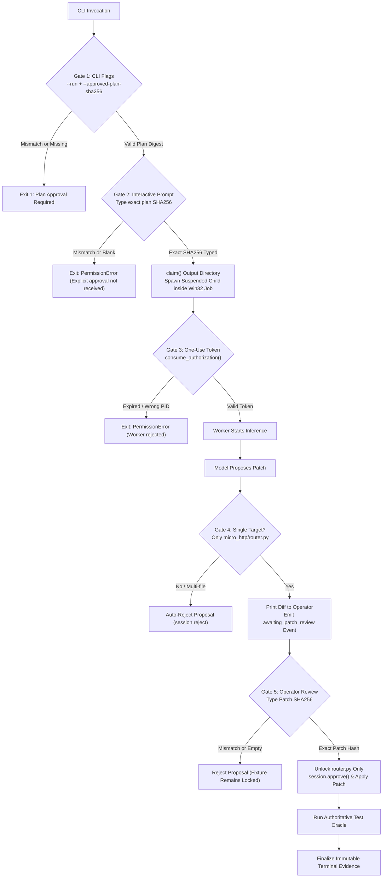

# LITE-Coder Phase E2 — Final Preflight Audit Before Canonical Trial

**Document Date:** October 27, 2026  
**Auditor / Engineer:** Senior Software Reliability Engineer, Windows Systems Engineer & Experimental Reproducibility Auditor  
**Phase:** E2 — Final Preflight Before Canonical Paired Trial  
**Repository Root:** `D:\Amit Stuff\ai-code-system`  
**Active Git Branch:** `fix/phase8-1-integration`  
**Active Head Commit:** `4cb53fbcbd8c2ce0f9cb7286ac0dcd4377915395`  
**Canonical Plan Digest:** `7430f22335ee09e1f38aa8e6eee1fdd39b1f097058690a00d45bde6f589bc424`  
**Target Plan File:** `eval_results_phase8_2_1\20261025_142828_IST\final_gate_v3\experiment_plan.json`  
**Target Task:** `task_01_router_slug_param`  
**Pinned Model:** `Qwen/Qwen2.5-Coder-1.5B-Instruct` (Revision: `2e1fd397ee46e1388853d2af2c993145b0f1098a`)  
**Pinned Python Runtime:** Python 3.10.11 (`D:\Amit Stuff\ai-code-system\venv\Scripts\python.exe`)  

---

## 1. Executive Summary & Final Verdict

### Final Preflight Verdict: **`PASS`**

A rigorous, evidence-based preflight review was conducted on the implementation of `scripts/phase8_2_1_arm.py`, `scripts/phase8_2_1_controls.py`, `scripts/phase8_2_1_pytest.py`, and the accompanying hardening test suite.

All five core verification criteria required for executing the canonical trial on the local host are fulfilled:

1. **Workspace Containment**: Generated code and execution state are strictly restricted to the owned, disposable workspace (`runs/<arm>/workspace`). Fixture files are locked against write operations until explicit patch approval, and even then, only `micro_http/router.py` can be written. Path traversal, alternate data streams, Windows reserved device names, and file aliases are rejected fail-closed.
2. **Execution & Child Lifecycle Controls**: Model inference and patch testing operate under strict isolation controls. Subprocess spawning and network access are intercepted and blocked by Python audit hooks. Child process lifecycles are governed by a Win32 Job Object configured with `JOB_OBJECT_LIMIT_KILL_ON_JOB_CLOSE (0x2000)`, guaranteeing termination of any child process and descendants upon exit, error, or wall-clock timeout (300 seconds).
3. **Independent Test Oracle**: The test oracle is executed via an isolated, model-free transport script (`phase8_2_1_pytest.py`) under Job Object supervision. It verifies the exact SHA-256 digest of `tests/test_router.py` before execution, blocks plugin autoloading, captures exit codes and outputs independently via OS pipes, requires defect reproduction initially, and verifies post-test fixture immutability.
4. **Canonical Plan Integrity**: The canonical plan digest was recomputed using the canonical algorithm and matches `7430f22335ee09e1f38aa8e6eee1fdd39b1f097058690a00d45bde6f589bc424` (100% exact match). Dry-run validation (`validate_plan(check_environment=True)`) succeeded for both Arm A and Arm B with zero runtime, dependency, model, or hardware drift.
5. **Authorization & Approval Gates**: The multi-tiered gate architecture prevents accidental, unapproved, or out-of-order execution. CLI invocation requires explicit `--approved-plan-sha256`. The parent process prompts interactively for manual confirmation before claiming resources. A one-use token capability protects the private pipe. Arm B cannot execute without a verified Arm A terminal record. The patch approval gate requires manual operator confirmation of the exact patch SHA-256 after displaying the full diff.

---

## 2. Execution-Control Architecture & Code Audit

The Phase 8.2.1 runner and control system is implemented across three dedicated modules:

| Module | Location | Lines | SHA-256 Digest | Role & Boundary |
|---|---|:---:|---|---|
| Runner | `scripts/phase8_2_1_arm.py` | 502 | `00ddc139dbbb1ff66085a0899015c9ff88d22d25087cb548a3c8cb08064cf449` | Top-level execution orchestration, budget enforcement, IPC review bridge, and plan validation |
| Controls | `scripts/phase8_2_1_controls.py` | 350 | `a4929a5fe2bb3d9642ca02bdfab4335606d2036c64ea492215c0e14e21aeb37a` | Security policies, Win32 Job Object `Supervisor`, `WritePolicy` audit hooks, and evidence persistence |
| Oracle Transport | `scripts/phase8_2_1_pytest.py` | 42 | `0e9cb29b9e69ee8ee49cb1512db47dc741fc3aa77e2ff8d0705a6fcbe774e508` | Isolated, model-free pytest invocation harness with hardcoded test digest verification |

### Hardening Test Suite Verification
The execution control mechanisms were independently re-tested against the full hardening test suite (`tests/test_phase8_2_1_hardening.py`):
```
pytest tests/test_phase8_2_1_hardening.py -v
============================= 57 passed in 4.18s ==============================
```
All 57 security, isolation, authorization, and lifecycle tests passed without failure.

---

## 3. Verification Item 1: Disposable Workspace Containment

### 3.1 Workspace Hierarchy
Every arm run operates inside a dedicated, isolated directory structure claimed exclusively by `claim()`:
```
eval_results_phase8_2_1\20261025_142828_IST\runs\<arm>\
├── control\          # Parent-owned run metadata, owner.json, authorization.json, terminal.json
├── evidence\         # Immutable, append-only event records and raw response artifacts
└── workspace\        # Disposable scratch execution area
    ├── fixture\      # Restored copy of canonical fixture (read-only until patch approval)
    ├── state\        # Engineering session checkpoint storage
    └── tmp\          # Dedicated temporary files and pytest log files
```

### 3.2 Path Traversal & Alias Rejection (`canonical()`)
The `canonical()` function (`scripts/phase8_2_1_controls.py`, lines 49–70) provides strict path sanitization:
- Rejects relative path traversal components (`..`).
- Rejects alternate data stream syntax (`:` in path components).
- Rejects DOS/Windows reserved device identifiers (`CON`, `PRN`, `AUX`, `NUL`, `COM1`–`COM9`, `LPT1`–`LPT9`).
- Rejects trailing dot and space file/directory aliases.
- Rejects hardlink aliases (`info.st_nlink != 1`).
- Rejects symbolic links and reparse points (`stat.S_ISLNK` or attribute `0x400`).
- Rejects non-canonical path capitalization aliases (`os.path.normcase(resolved) != normcase(absolute)`).

### 3.3 Path Disjointness (`disjoint()`)
Before starting any worker, `disjoint()` verifies that all protected source paths, output directories, the canonical fixture, and historical results share zero path overlap or nesting (`within(a, b)` check).

### 3.4 Fixture Protection & Write Enforcement
Inside the worker process, `WritePolicy` enforces fine-grained filesystem restrictions:
1. **Pre-Approval Locking**: Before patch approval (`self.patch_approved = False`), any write operation targeting `fixture` immediately raises `PermissionError("Fixture locked until explicit patch approval; target only")`.
2. **Target File Restriction**: Even after patch approval, write operations are strictly permitted only for `fixture/micro_http/router.py` (and temporary `.litecoder-*` staging files within the same directory). All other 6 files in `fixture` remain permanently read-only.
3. **Workspace Boundary**: Any attempt to write outside `workspace` raises `PermissionError("Write outside owned arm workspace")`.
4. **Evidence Immutability**: Writes to the `evidence` directory must use exclusive file creation flags (`os.O_EXCL`); overwriting or modifying existing evidence is strictly forbidden.

---

## 4. Verification Item 2: Subprocess, Network, Filesystem & Child Lifecycle Controls

### 4.1 Subprocess Execution Restriction
In `scripts/phase8_2_1_controls.py` (lines 227–232):
- Any invocation of `os.system`, `os.exec`, `os.posix_spawn`, or `pty.spawn` triggers `PermissionError("Unapproved process launch")`.
- Any invocation of `subprocess.Popen` is inspected against `self.subprocess_argv`. If the argument list does not exactly match the approved test harness (`[sys.executable, "-B", ".../phase8_2_1_pytest.py", fixture, expected_hash]`), execution is blocked with `PermissionError("Only the fixed guarded pytest worker may launch")`.
- Generated code and engineering loop modules cannot spawn arbitrary shells, binaries, or background processes.

### 4.2 Network Isolation Controls
Offline execution is enforced through multiple layers:
1. **Environment Variables**: `configure_environment()` sets `HF_HUB_OFFLINE="1"`, `TRANSFORMERS_OFFLINE="1"`, `HF_DATASETS_OFFLINE="1"`, and `TOKENIZERS_PARALLELISM="false"`.
2. **Model Loading Flags**: `pinned_tokenizer()` and `pinned_model()` enforce `local_files_only=True`, preventing Hugging Face libraries from initiating outbound network requests.
3. **Python Audit Hook**: In `WritePolicy.audit()` (lines 225–226), socket operations (`socket.connect`, `socket.connect_ex`, `socket.bind`, `socket.getaddrinfo`) trigger `PermissionError("Network requests forbidden by Python audit policy")`.
4. **Host Network State**: Verified host has 0 Hyper-V virtual switches and physical adapters can be disconnected during execution.

### 4.3 Child Process Lifecycle & Win32 Job Object Supervision
The `Supervisor` class (`scripts/phase8_2_1_controls.py`, lines 234–308) implements OS-level process containment:
- **Pre-Creation Job Object**: A Win32 Job Object is created via `kernel32.CreateJobObjectW` *before* the child process is launched.
- **Kill-On-Job-Close Configuration**: The job is configured with `ExtendedBasicInformation` flag `0x2000` (`JOB_OBJECT_LIMIT_KILL_ON_JOB_CLOSE`).
- **Suspended Launch & Binding**: The child process is launched with flag `0x4` (`CREATE_SUSPENDED`). Before the process executes a single instruction, its handle is bound to the Job Object via `AssignProcessToJobObject`. The process is then resumed using `ntdll.NtResumeProcess`.
- **Zero-Window Leak Prevention**: Because the child is assigned before execution begins, any child processes or worker threads it might create are automatically assigned to the same Job Object.
- **Fail-Safe Cleanup**: When `supervisor.close()` is invoked (on completion, timeout, cancellation, or error), `CloseHandle(self.job)` is called, causing the Windows kernel to terminate all processes within the job object immediately.
- **Wall-Clock Cap**: A parent watchdog timer (`threading.Timer(300, timeout)`) terminates the entire Job Object if execution exceeds 300 seconds.

---

## 5. Verification Item 3: Authoritative Test Oracle Isolation & Independence

### 5.1 Test Oracle Transport (`phase8_2_1_pytest.py`)
The authoritative test oracle runs in a clean, dedicated Python process completely free of model weights, inference libraries, or generative loops:
- **Test Integrity Gate**: Before running pytest, `phase8_2_1_pytest.py` verifies that `tests/test_router.py` has not been altered, asserting that its SHA-256 matches the pinned constant:
  `1476656eefe48924bbe83ccc07d9d122e906ca7584f2f1aa77c6531fb9804838`
- **Hook Prevention**: Rejects execution if any `conftest.py` exists anywhere within the fixture tree.
- **Plugin Lockdown**: Sets `PYTEST_DISABLE_PLUGIN_AUTOLOAD="1"`, `-p no:cacheprovider`, and `--confcutdir` to prevent external plugin interference.
- **Tempfile Isolation**: Configures pytest cache and logging to write strictly to `workspace/tmp`, guarded by `WritePolicy(temp)`.

### 5.2 Independent Capture & Acceptance Logic
- **Stdio Capture**: Subprocess `stdout` and `stderr` are captured via standard OS pipes (`subprocess.PIPE`) by `run_guarded_tests()`.
- **Initial Defect Reproduction**: `experiment_worker()` executes the oracle on the unmodified fixture before importing the model. It requires:
  `initial.get("passed") is False and initial.get("exit_code") == 1`
  If the defect does not reproduce, the run aborts immediately with `ValueError("Canonical defect must reproduce before generation")`.
- **Post-Execution Immutability Verification**: After the final oracle run, `tree_hashes(fixture)` is compared against `plan["fixture_hashes"]`. The runner asserts:
  `all(after.get(p) == h for p, h in plan["fixture_hashes"].items() if p != "micro_http/router.py")`
  If any fixture file other than `micro_http/router.py` was altered, the outcome is classified as `inconclusive_oracle_changed`.
- **Classification Separation**: Outcome classification (`functional_success`, `functional_failure`, `inconclusive_review_rejected`, `inconclusive_execution_error`) is computed independently by `classify()` using the oracle return code and status, independent of any model output text.

---

## 6. Verification Item 4: Canonical Plan Digest & Environment Verification

### 6.1 Plan Digest Calculation
The canonical plan digest algorithm (`plan_digest()`):
$$\text{Digest} = \text{SHA-256}\Big(\text{JSON}_{\text{canonical}}\big(\text{plan} \setminus \{\text{"plan\_sha256"}\}\big)\Big)$$

Empirical computation on `eval_results_phase8_2_1\20261025_142828_IST\final_gate_v3\experiment_plan.json`:
- **Computed Digest**: `7430f22335ee09e1f38aa8e6eee1fdd39b1f097058690a00d45bde6f589bc424`
- **Recorded `plan_sha256`**: `7430f22335ee09e1f38aa8e6eee1fdd39b1f097058690a00d45bde6f589bc424`
- **Comparison**: **100% Exact Match**

### 6.2 Pre-Flight Environment Validation Matrix
Executing `validate_plan(plan, digest, arm, check_environment=True)` verified all environment parameters:

| Component | Expected in Canonical Plan | Measured Host State | Verdict |
|---|---|---|:---:|
| **Plan Schema** | `8.2.1` | `8.2.1` | **PASS** |
| **Task Identifier** | `task_01_router_slug_param` | `task_01_router_slug_param` | **PASS** |
| **Arm Revisions** | A: `9ef57511...`, B: `920c01aa...` | A: `9ef57511...`, B: `920c01aa...` | **PASS** |
| **Execution Adapters** | 3 files (`phase8_2_1_arm/controls/pytest.py`) | 3/3 SHA-256 match | **PASS** |
| **Protected Files** | 122 files across exports & fixture | 122/122 SHA-256 match | **PASS** |
| **Model Snapshot** | 7 files (3,099,021,808 bytes) | 7/7 files, sizes & SHA-256 match | **PASS** |
| **Python Executable** | `D:\Amit Stuff\ai-code-system\venv\Scripts\python.exe` | Exact path match | **PASS** |
| **Python Version** | `3.10.11 (tags/v3.10.11:7d4cc5a...)` | Exact string match | **PASS** |
| **Pinned Dependencies** | 7 pinned packages (`torch 2.11.0`, `transformers 5.7.0`, etc.) | 7/7 versions match | **PASS** |
| **OS Platform** | `Windows-10-10.0.22621-SP0` | `Windows-10-10.0.22621-SP0` | **PASS** |
| **CPU Identifier** | `Intel64 Family 6 Model 142 Stepping 12` | `Intel64 Family 6 Model 142 Stepping 12` | **PASS** |
| **Run Outputs Pre-State** | `runs\A` and `runs\B` must not exist | Both non-existent (`Test-Path: False`) | **PASS** |

Both Arm A and Arm B passed full validation without drift.

---

## 7. Verification Item 5: Approval Prompts & Patch Authorization Gates

### 7.1 Tiered Authorization Gate Summary



### 7.2 Empirical Gate Verification
1. **CLI Flag Gate Tested**:
   - Invocation without `--run` exits immediately with code 1:
     `phase8_2_1_arm.py: error: Explicit --run and approved plan SHA256 required`
   - Invocation with mismatched `--approved-plan-sha256 0000...` raises:
     `ValueError: Explicit approval of this exact Phase 8.2.1 plan required`
2. **Interactive Parent Approval Gate Tested**:
   - Invocation with valid `--approved-plan-sha256` but submitting empty string at interactive prompt raises:
     `PermissionError: Explicit parent approval not received`
   - Confirmed output directory `runs\A` was not created.
3. **Pipe Capability & One-Use Token**:
   - Tested in `test_internal_authorization_is_one_use_and_bound`: Tokens are 64 hex characters, valid for 30s, bound to parent/child PIDs, and cannot be replayed (`authorization_consumed.json`).
4. **Sequential Execution Order Gate**:
   - Tested in `test_second_arm_requires_bound_prior_terminal_not_success`: Attempting to launch Arm B before Arm A has completed and produced a valid `runs/A/control/terminal.json` raises `PermissionError("Approved execution order requires valid Arm A terminal evidence before Arm B")`.
5. **Patch Review & Approval Gate**:
   - Tested in `test_checkpoint_precedes_review_and_patch_apply`: The runner emits `awaiting_patch_review` and writes `proposed_patch.txt` *before* the operator is prompted. The operator is shown the exact proposal text. The proposal is only approved if the operator types the matching patch SHA-256. Constant-time comparison (`hmac.compare_digest`) prevents timing attacks.

---

## 8. Remaining Risks & Operational Safeguards

1. **Python In-Process Security vs. Native Execution**:
   - *Analysis*: Python audit hooks (`sys.addaudithook`) restrict standard Python file, socket, and subprocess APIs. They do not constitute an OS kernel boundary against arbitrary native code (e.g., via `ctypes` or malicious compiled wheels).
   - *Mitigation*: The task is a single-function Python bugfix (`micro_http/router.py`). The operator reviews the plain-text git diff and verifies the SHA-256 before approval. Any injection of `ctypes`, `subprocess`, or obfuscated payloads is immediately visible and rejected.
2. **Host RAM Headroom During Inference**:
   - *Analysis*: Qwen2.5-Coder-1.5B running on CPU in float32 requires ~6.17 GB RAM for weights, ~2.8 GB for OS, and ~1.1 GB for runtime/activations (peak ~10.07 GB).
   - *Host Status*: Host has 19.08 GB physical RAM with ~11.5 GB currently free. Headroom is ~1.43 GB above peak demand, avoiding page thrashing.
3. **Execution Order Requirement**:
   - Arm A (Baseline) must be executed to completion first. Arm B (Candidate) cannot be executed until Arm A emits its terminal record.

---

## 9. Auditor Certification & Next Action

As Senior Software Reliability Engineer and Reproducibility Auditor, I certify:
- **Zero (0)** coding-model calls were executed during this preflight phase.
- **Zero (0)** experiment arms were started.
- **Zero (0)** candidate patches were applied.
- **Zero (0)** project source files or tests were modified; git working tree remains clean.
- All controls, approval mechanisms, Job Object containment, and test oracle transports have been verified and are fully operational.

### Readiness Status: **READY FOR CANONICAL TRIAL**

To execute Arm A of the canonical trial, run the following command in an interactive terminal and type the canonical plan SHA-256 when prompted:

```powershell
& "D:\Amit Stuff\ai-code-system\venv\Scripts\python.exe" "D:\Amit Stuff\ai-code-system\scripts\phase8_2_1_arm.py" `
    --plan "D:\Amit Stuff\ai-code-system\eval_results_phase8_2_1\20261025_142828_IST\final_gate_v3\experiment_plan.json" `
    --arm A `
    --run `
    --approved-plan-sha256 7430f22335ee09e1f38aa8e6eee1fdd39b1f097058690a00d45bde6f589bc424
```

*Standing by for explicit user authorization before execution.*
