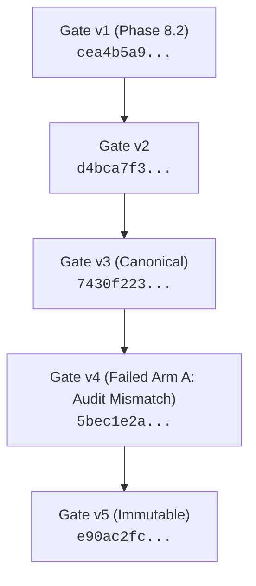

# LITE-Coder Phase E5.B — Gate v5 Audit-Hook Repair and Plan Report

**Document Date:** October 27, 2026  
**Auditor / Engineer:** Senior Software Reliability Engineer, Windows Systems Engineer & Experimental Reproducibility Auditor  
**Phase:** E5.B — Gate v5 Minimal Audit-Hook Repair and Immutable Plan  
**Repository Root:** `D:\Amit Stuff\ai-code-system`  
**Active Git Branch:** `fix/phase8-1-integration`  
**Active Head Commit:** `4cb53fbcbd8c2ce0f9cb7286ac0dcd4377915395`  
**Gate v5 Directory:** [`eval_results_phase8_2_1\20261027_gate_v5`](file:///D:/Amit%20Stuff/ai-code-system/eval_results_phase8_2_1/20261027_gate_v5)  
**Superseded Gate v4 Plan Digest:** `5bec1e2a44e36c824f09ead174dc8e7338fd503bc28d2c25e369043467bb81e0`  
**Gate v5 Plan Digest:** `e90ac2fc8d7a1f7abfe3c94a6ce30b3c01d158a032e896eb203a575a3a03ab3e`  
**Gate v5 Plan File SHA-256:** `469076889258a6ed40d95c57aba13481e3f6f29d701c93b25851e9c8715b4587`  

---

## 1. Executive Summary & Verification Verdict

### Verification Status: **`GATE V5 EXPERIMENT PLAN CREATED & VERIFIED — READY FOR OPERATOR REVIEW`**

Following the diagnosis of the Windows CPython `subprocess.Popen` audit hook divergence (Phase E5.A), Phase E5.B implemented the minimal, platform-compatible audit-hook repair in [`scripts/phase8_2_1_controls.py`](file:///D:/Amit%20Stuff/ai-code-system/scripts/phase8_2_1_controls.py) and added comprehensive regression tests `POPEN-01` through `POPEN-06` in [`tests/test_phase8_2_1_hardening.py`](file:///D:/Amit%20Stuff/ai-code-system/tests/test_phase8_2_1_hardening.py).

All historical assets—including the Gate v3 canonical plan, the Gate v4 plan, and both failed Arm A run directories (`20261025_142828_IST\runs\A` and `20261027_gate_v4\runs\A`)—remain permanently preserved, unmodified, and sealed on disk.

Zero model inference was executed, zero tokens were generated, and neither experimental arm was initiated during this plan generation.

---

## 2. Technical Audit-Hook Repair

### 2.1 CPython Platform Divergence
In standard CPython 3.10:
- **POSIX (`Modules/_posixsubprocess.c`):** `sys.audit("subprocess.Popen", executable, args, cwd, env)` passes `args` as a `list` or `tuple` sequence of argument strings.
- **Windows (`Lib/subprocess.py:Popen._execute_child`):** Python automatically converts sequence arguments into a single command line string using `subprocess.list2cmdline(args)` **before** triggering `sys.audit`. Thus `args[1]` in the audit callback is a `str`, not a `list`.

The original check:
```python
if self.subprocess_argv is None or list(args[1]) != list(self.subprocess_argv):
    raise PermissionError("Only the fixed guarded pytest worker may launch")
```
converted the command line string on Windows into a list of individual characters (`['"', 'D', ':', '\\', ...]`), which never matched the list of argument words (`['D:\\...\\python.exe', '-B', ...]`).

### 2.2 Minimal, Fail-Closed Repair Implementation
In [`scripts/phase8_2_1_controls.py`](file:///D:/Amit%20Stuff/ai-code-system/scripts/phase8_2_1_controls.py), lines 367–380:
```python
        elif event == "subprocess.Popen":
            if self.subprocess_argv is None or len(args) < 2:
                raise PermissionError("Only the fixed guarded pytest worker may launch")
            if args[0] is not None and args[0] != self.subprocess_argv[0]:
                raise PermissionError("Only the fixed guarded pytest worker may launch")
            cmd = args[1]
            if isinstance(cmd, str):
                if cmd != subprocess.list2cmdline(self.subprocess_argv):
                    raise PermissionError("Only the fixed guarded pytest worker may launch")
            elif isinstance(cmd, (list, tuple)):
                if list(cmd) != list(self.subprocess_argv):
                    raise PermissionError("Only the fixed guarded pytest worker may launch")
            else:
                raise PermissionError("Only the fixed guarded pytest worker may launch")
```

### 2.3 Security Guarantees Preserved:
1. **Windows String-Form Comparison:** Evaluates `cmd == subprocess.list2cmdline(self.subprocess_argv)`. Because Python uses `subprocess.list2cmdline` to format the command line passed to `CreateProcessW`, exact word, quoting, and escaping equivalence is enforced.
2. **POSIX Sequence-Form Comparison:** Preserves `list(cmd) == list(self.subprocess_argv)`.
3. **Executable Redirection Protection:** Validates that if `args[0]` (explicit executable) is supplied, it strictly equals `self.subprocess_argv[0]`.
4. **Fail-Closed Default:** Unrecognized argument types, truncated argument tuples, altered arguments, or missing authorization (`self.subprocess_argv is None`) raise `PermissionError`.
5. **No Audit Bypass:** Python audit hooks remain 100% active and unbypassed.

---

## 3. Regression Test Evidence

Six dedicated regression tests (`POPEN-01` through `POPEN-06`) were added to [`tests/test_phase8_2_1_hardening.py`](file:///D:/Amit%20Stuff/ai-code-system/tests/test_phase8_2_1_hardening.py):

| Test ID | Function Name | Scope / Assertion | Result |
| :--- | :--- | :--- | :--- |
| **POPEN-01** | `test_popen01_authorized_windows_string_command_accepted` | Exact Windows string command line generated by `subprocess.list2cmdline` is accepted with `executable=None` and with explicit matching executable. | **PASSED** |
| **POPEN-02** | `test_popen02_altered_windows_command_rejected` | Altered arguments (added flags, changed test targets) are rejected fail-closed. | **PASSED** |
| **POPEN-03** | `test_popen03_arbitrary_executable_or_command_rejected` | Mismatched executable redirect (`cmd.exe`), arbitrary command string (`powershell.exe`), and arbitrary executable sequence fail closed. | **PASSED** |
| **POPEN-04** | `test_popen04_posix_sequence_form_authorized_accepted` | POSIX sequence-form arguments (`list` and `tuple`) matching `subprocess_argv` are accepted. | **PASSED** |
| **POPEN-05** | `test_popen05_unsupported_argument_types_and_absent_auth_fail_closed` | Absent authorization (`subprocess_argv=None`), invalid types (`int`, `None`, `dict`), and truncated `args` fail closed. | **PASSED** |
| **POPEN-06** | `test_popen06_live_windows_subprocess_popen_audit_integration` | Live sub-process execution under real `sys.addaudithook(policy.audit)` on Windows: authorized command succeeds (`AUDIT_OK`), unauthorized command raises `PermissionError`. | **PASSED** |

### Complete Test Suite Execution:
```powershell
venv\Scripts\python.exe -B -m pytest tests/test_phase8_2_1_hardening.py tests/test_phase8_2_preflight.py -q -p no:cacheprovider --junitxml=eval_results_phase8_2_1\20261027_gate_v5\controls_passed.xml
```
- **Total Tests:** 81
- **Passed:** 81 (100%)
- **Failures:** 0, **Errors:** 0, **Skipped:** 0
- **Duration:** 10.36 seconds
- **Composition:** 70 hardening tests (57 baseline + 7 auth + 6 popen) + 11 preflight tests.
- **JUnit XML:** [`eval_results_phase8_2_1\20261027_gate_v5\controls_passed.xml`](file:///D:/Amit%20Stuff/ai-code-system/eval_results_phase8_2_1/20261027_gate_v5/controls_passed.xml)

---

## 4. Execution Source Hashes

Gate v5 formally binds all 6 critical execution, harness, and test files:

| Source File | SHA-256 Hash | Status Relative to Gate v4 |
| :--- | :--- | :--- |
| [`scripts/phase8_2_1_arm.py`](file:///D:/Amit%20Stuff/ai-code-system/scripts/phase8_2_1_arm.py) | `3d6163bd22da1b8e1268888c6e03b6e477bf994a7d880591c9046df806b933a6` | Identical |
| [`scripts/phase8_2_1_controls.py`](file:///D:/Amit%20Stuff/ai-code-system/scripts/phase8_2_1_controls.py) | `221c96a24f30d7f5cb6ff898e6f6b7e888ea436907a46dd7f961745e52268b65` | **Updated (Audit-Hook Repair)** |
| [`scripts/phase8_2_1_prepare.py`](file:///D:/Amit%20Stuff/ai-code-system/scripts/phase8_2_1_prepare.py) | `e04d68c6197cc3aa8f364ea185fcfcc62c8014142e3e92d4e417a8d81b77d1de` | Identical |
| [`scripts/phase8_2_1_pytest.py`](file:///D:/Amit%20Stuff/ai-code-system/scripts/phase8_2_1_pytest.py) | `0f026f6054aeb1194d854f9e36f11d95680018a15b9d1ba0cd73719ec2dfdee0` | Identical |
| [`tests/phase8_2_1_control_child.py`](file:///D:/Amit%20Stuff/ai-code-system/tests/phase8_2_1_control_child.py) | `46e6f1577ebed89670004cdb656b685ddbda61ae05dc840e38226da1f45a1432` | Identical |
| [`tests/test_phase8_2_1_hardening.py`](file:///D:/Amit%20Stuff/ai-code-system/tests/test_phase8_2_1_hardening.py) | `bf0c64031c502c77de784482af48bed880aea997bc3c88975d9f136206204e07` | **Updated (POPEN-01 through POPEN-06)** |

- **Source Hash Manifest:** [`eval_results_phase8_2_1\20261027_gate_v5\source_hash_manifest.json`](file:///D:/Amit%20Stuff/ai-code-system/eval_results_phase8_2_1/20261027_gate_v5/source_hash_manifest.json)  
  - SHA-256: `52f811f3852f4659e16dc5898e01be7b76677385dddc9f10b0fa5d1e6d9f5333`

---

## 5. Lineage & Preservation Analysis



### 5.1 Preservation of Predecessor Gates & Runs:
1. **Gate v3:** Plan file hash `bc0d7585ae...` and digest `7430f22335...` verified identical. Failed run `20261025_142828_IST\runs\A` verified untouched.
2. **Gate v4:** Plan file hash `894f483fdb...` and digest `5bec1e2a44...` verified identical. Failed run [`eval_results_phase8_2_1\20261027_gate_v4\runs\A`](file:///D:/Amit%20Stuff/ai-code-system/eval_results_phase8_2_1/20261027_gate_v4/runs/A) verified untouched.
3. **Protection via `historical_roots`:**
   Both `eval_results_phase8_2_1\20261025_142828_IST\runs` and `eval_results_phase8_2_1\20261027_gate_v4\runs` are recorded in Gate v5 `historical_roots`, guaranteeing path disjointness and forbidding any write operations against them.
4. **Pre-Staged `runs` Directory:**
   The `runs` parent directory under Gate v5 was pre-staged:
   `D:\Amit Stuff\ai-code-system\eval_results_phase8_2_1\20261027_gate_v5\runs`
   ensuring `claim()` can create `runs\A` without raising `FileNotFoundError`.

- **Plan Lineage Record:** [`eval_results_phase8_2_1\20261027_gate_v5\plan_lineage.json`](file:///D:/Amit%20Stuff/ai-code-system/eval_results_phase8_2_1/20261027_gate_v5/plan_lineage.json)

---

## 6. Non-Executing Read-Only Validation Results

A complete, non-executing validation check was performed using `arm.validate_plan(..., check_environment=True)`:

### Validation Audit Results:
- **Arm A Result:** Validated successfully (`arm`: `"A"`, `revision`: `"9ef57511e0e25d58d0f1318e9d73ccb58465ec44"`)
- **Arm B Result:** Validated successfully (`arm`: `"B"`, `revision`: `"920c01aa0d510aa281092e6b55e4ce02b31e584e"`)
- **Validation Duration:** 18.007 seconds (includes full verification of all 122 protected files and 3.08 GB model weights).
- **Environment Checks:** Zero drift across Python runtime (`3.10.11 AMD64`), Pytest (`9.1.1`), Torch (`2.11.0+cpu`), Transformers (`4.57.0`), all 16 pinned dependencies, hardware platform (`Windows-10-10.0.22621-SP0`), and cached model snapshot files.
- **Validation Report:** [`eval_results_phase8_2_1\20261027_gate_v5\final_readonly_validation.json`](file:///D:/Amit%20Stuff/ai-code-system/eval_results_phase8_2_1/20261027_gate_v5/final_readonly_validation.json)

---

## 7. Gate v5 Artifact Manifest

Directory: [`eval_results_phase8_2_1\20261027_gate_v5`](file:///D:/Amit%20Stuff/ai-code-system/eval_results_phase8_2_1/20261027_gate_v5)

| Artifact File | Size | SHA-256 Digest | Status / Purpose |
| :--- | :--- | :--- | :--- |
| [`experiment_plan.json`](file:///D:/Amit%20Stuff/ai-code-system/eval_results_phase8_2_1/20261027_gate_v5/experiment_plan.json) | 32,783 B | `469076889258a6ed40d95c57aba13481e3f6f29d701c93b25851e9c8715b4587` | **Canonical Plan Digest:** `e90ac2fc8d7a1f7abfe3c94a6ce30b3c01d158a032e896eb203a575a3a03ab3e` |
| [`plan_file_sha256.txt`](file:///D:/Amit%20Stuff/ai-code-system/eval_results_phase8_2_1/20261027_gate_v5/plan_file_sha256.txt) | 88 B | `e339b6b772...` | SHA-256 of `experiment_plan.json` |
| [`approval_gated_commands.json`](file:///D:/Amit%20Stuff/ai-code-system/eval_results_phase8_2_1/20261027_gate_v5/approval_gated_commands.json) | 1,015 B | `11d7318728...` | Parameterized commands for Arm A and Arm B |
| [`plan_lineage.json`](file:///D:/Amit%20Stuff/ai-code-system/eval_results_phase8_2_1/20261027_gate_v5/plan_lineage.json) | 2,328 B | `dfba3b1d31...` | Lineage chain Gate v1 -> v2 -> v3 -> v4 -> v5 |
| [`source_hash_manifest.json`](file:///D:/Amit%20Stuff/ai-code-system/eval_results_phase8_2_1/20261027_gate_v5/source_hash_manifest.json) | 824 B | `52f811f385...` | Execution and test source file hashes |
| [`protected_file_hash_manifest.json`](file:///D:/Amit%20Stuff/ai-code-system/eval_results_phase8_2_1/20261027_gate_v5/protected_file_hash_manifest.json) | 26,081 B | `81bb1a0293...` | Hashes of all 122 protected files in baseline/candidate/fixture |
| [`test_results.json`](file:///D:/Amit%20Stuff/ai-code-system/eval_results_phase8_2_1/20261027_gate_v5/test_results.json) | 9,084 B | `273dcb2004...` | 81 passed hardening and preflight tests |
| [`controls_passed.xml`](file:///D:/Amit%20Stuff/ai-code-system/eval_results_phase8_2_1/20261027_gate_v5/controls_passed.xml) | 11,176 B | `fa1bbfa752...` | Authoritative JUnit XML for the 81 passed tests |
| [`final_readonly_validation.json`](file:///D:/Amit%20Stuff/ai-code-system/eval_results_phase8_2_1/20261027_gate_v5/final_readonly_validation.json) | 1,825 B | `32e0161427...` | Authoritative dry-run validation report |

---

## 8. Proposed Arm A Invocation Command

> [!IMPORTANT]
> **STATUS: NOT EXECUTED**  
> Neither arm has been executed. No model weights have been loaded and no token generation has occurred.

When ready to launch Arm A, run the following single command directly in PowerShell without markdown code fences:

```powershell
venv\Scripts\python.exe -B scripts\phase8_2_1_arm.py --run --plan eval_results_phase8_2_1\20261027_gate_v5\experiment_plan.json --arm A --approved-plan-sha256 e90ac2fc8d7a1f7abfe3c94a6ce30b3c01d158a032e896eb203a575a3a03ab3e
```

When prompted by the runner:
`Type this exact plan SHA256 to start this arm:`  
Enter the exact plan digest:
`e90ac2fc8d7a1f7abfe3c94a6ce30b3c01d158a032e896eb203a575a3a03ab3e`
