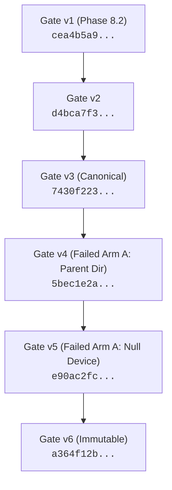

# LITE-Coder Phase E6 — Null-Device Audit Compatibility Repair and Gate v6 Plan Report

**Document Date:** October 27, 2026  
**Auditor / Engineer:** Senior Software Reliability Engineer, Windows Systems Engineer & Experimental Reproducibility Auditor  
**Phase:** E6 — Null-Device Audit Compatibility Repair and Gate v6 Plan  
**Repository Root:** `D:\Amit Stuff\ai-code-system`  
**Active Git Branch:** `fix/phase8-1-integration`  
**Active Head Commit:** `4cb53fbcbd8c2ce0f9cb7286ac0dcd4377915395`  
**Gate v6 Directory:** [`eval_results_phase8_2_1\20261027_gate_v6`](file:///D:/Amit%20Stuff/ai-code-system/eval_results_phase8_2_1/20261027_gate_v6)  
**Superseded Gate v5 Plan Digest:** `e90ac2fc8d7a1f7abfe3c94a6ce30b3c01d158a032e896eb203a575a3a03ab3e`  
**Gate v6 Canonical Plan Digest:** `a364f12bba42d5665963de1f1126021d63467db2892d69fbce6a519bba0fd950`  
**Gate v6 Raw Plan File SHA-256:** `cd79917b7775d995ffc15dcb0e0d3fca9d284c351f7b0e2d188626dd9c0b2fd2`  

---

## 1. Executive Summary & Verification Verdict

### Verification Status: **`GATE V6 EXPERIMENT PLAN CREATED & VERIFIED — READY FOR OPERATOR REVIEW`**

During the Gate v5 Arm A launch attempt, the runner achieved a major milestone: the Phase E5 Windows `subprocess.Popen` audit hook fix succeeded completely, and the isolated pytest worker successfully executed the initial baseline oracle test, reproduced the canonical router bug (`FAILED test_slug_with_hyphen - assert False is True`, exit code 1), and committed the `initial_oracle` event to durable evidence.

Immediately following initial oracle success, the worker halted at line 242 of [`scripts/phase8_2_1_arm.py`](file:///D:/Amit%20Stuff/ai-code-system/scripts/phase8_2_1_arm.py) during `import app.engineering_loop as loop` with:
```
PermissionError: Write outside owned arm workspace
```
Investigation revealed that the standard library dependency `dill` (imported via `torch.utils.data.datapipes`) probes Python file-type descriptors at import time by opening `os.devnull` with mode `'r+b'` (`os.O_RDWR`). Because `canonical(os.devnull)` (`\\.\nul\` on Windows) is outside the arm workspace directory, the security audit hook intercepted and rejected the call.

Phase E6 implemented the narrowest, fail-closed compatibility repair: allowing only the canonical OS null-device path for `open` events as a discard sink, while keeping all filesystem writes, non-open operations, lookalike paths, and workspace boundaries strictly enforced. Five dedicated regression tests (`DEVNULL-01` through `DEVNULL-05`) were added, and all 86 model-free tests passed.

Zero model weights were loaded, zero model inference calls occurred, and zero tokens were generated.

---

## 2. Root-Cause Evidence & Audit Hook Behavior

### 2.1 Audit Event Inspection
By attaching an audit hook directly to `open(os.devnull, 'r+b')` on Python 3.10 Windows, the exact parameters were established:
- **Event:** `"open"`
- **Path Representation (`args[0]`):** `'nul'`
- **Mode (`args[1]`):** `'r+'`
- **Flags (`args[2]`):** `0x8082` (`_O_BINARY | _O_RDWR`)
- **Flags Analysis:** `flags & os.O_RDWR` is `True` (0x0002).

In [`scripts/phase8_2_1_controls.py:WritePolicy.audit`](file:///D:/Amit%20Stuff/ai-code-system/scripts/phase8_2_1_controls.py#L351):
```python
if flags & (os.O_WRONLY | os.O_RDWR | os.O_CREAT | os.O_TRUNC | os.O_APPEND):
    self.check(path, exclusive_only=bool(flags & os.O_EXCL))
```
`check(path)` evaluated `canonical(path)`. On Windows, `canonical('nul')` resolves to `WindowsPath('//./nul/')`.
Because `within(WindowsPath('//./nul/'), self.workspace)` is `False`, line 341 raised `PermissionError("Write outside owned arm workspace")`.

### 2.2 Necessity of Exemption
The call to `open(os.devnull, 'r+b')` originates in `dill/_dill.py:165`:
```python
BufferedRandomType = None if IS_PYODIDE else get_file_type('r+b', buffering=-1)
```
This module-level constant is required for `dill` to initialize its pickling dispatch table. Without allowing `os.devnull` to open, `dill` cannot be imported, blocking `torch` and `app.engineering_loop`.

### 2.3 Safety Analysis of the OS Null Device
- **Discard Sink:** The OS null device (`NUL` / `/dev/null`) is a kernel-level bit-bucket. Writing to it discards all bytes in memory; reading from it returns immediate EOF.
- **No Disk Storage:** The null device does not map to any storage block, directory, or inode. It cannot create files, modify files, or persist data.
- **Lookalike Path Protection:** The existing path canonicalization in [`scripts/phase8_2_1_controls.py:canonical`](file:///D:/Amit%20Stuff/ai-code-system/scripts/phase8_2_1_controls.py#L40-L62) explicitly checks:
  ```python
  reserved = {"CON", "PRN", "AUX", "NUL", ...}
  if os.name == "nt" and any(p.rstrip(" .") != p or p.split(".")[0].upper() in reserved for p in path.parts[1:]):
      raise ValueError("Windows device or trailing-dot/space alias forbidden")
  ```
  Lookalike paths such as `sub/nul`, `workspace/nul`, and `C:\nul.txt` raise `ValueError` and are rejected before any filesystem operation can occur.
  Ordinary files such as `nul.txt` or `NUL.DAT` resolve to ordinary paths (`D:\...\nul.txt`) and do not equal `canonical(os.devnull)`.

---

## 3. Minimal Safe Implementation Diff

The repair was implemented strictly inside `WritePolicy.audit("open")` in [`scripts/phase8_2_1_controls.py`](file:///D:/Amit%20Stuff/ai-code-system/scripts/phase8_2_1_controls.py#L348-L355):

```diff
--- a/scripts/phase8_2_1_controls.py
+++ b/scripts/phase8_2_1_controls.py
@@ -348,6 +348,8 @@ class WritePolicy:
     def audit(self, event, args):
         if event == "open":
             path, mode, flags = args
             if flags & (os.O_WRONLY | os.O_RDWR | os.O_CREAT | os.O_TRUNC | os.O_APPEND):
+                if not isinstance(path, int) and canonical(os.fsdecode(path)) == canonical(os.devnull):
+                    return  # canonical OS null-device discard sink; required for library import type probing (e.g. dill/torch)
                 self.check(path, exclusive_only=bool(flags & os.O_EXCL))
```

### Security Properties Preserved:
1. **Narrow Scope:** The exemption applies **strictly to `event == "open"`**. It does not apply to `os.remove`, `os.truncate`, `os.chmod`, `os.rename`, or any other filesystem event.
2. **Exact Identity:** It matches only `canonical(os.fsdecode(path)) == canonical(os.devnull)`.
3. **No General Bypass:** All ordinary file paths outside `workspace` continue to call `self.check(path)` and fail closed.
4. **No Integer FD Bypass:** Integer descriptors continue through the existing checked descriptor path.

---

## 4. Regression Test Results

Five regression tests (`DEVNULL-01` through `DEVNULL-05`) were added to [`tests/test_phase8_2_1_hardening.py`](file:///D:/Amit%20Stuff/ai-code-system/tests/test_phase8_2_1_hardening.py):

| Test ID | Function Name | Scope / Assertion | Result |
| :--- | :--- | :--- | :--- |
| **DEVNULL-01** | `test_devnull01_legitimate_devnull_open_accepted` | Legitimate `os.devnull` open in `'r+b'` mode (`O_RDWR`) and `'w'` mode (`O_WRONLY | O_CREAT`) is accepted. | **PASSED** |
| **DEVNULL-02** | `test_devnull02_ordinary_writes_outside_workspace_remain_denied` | Attempts to open ordinary files outside workspace in `'w'` and `'r+'` modes raise `PermissionError`. | **PASSED** |
| **DEVNULL-03** | `test_devnull03_lookalike_paths_denied` | Lookalike paths (`nul.txt`, `NUL.DAT`, `nul_file`, `parent/nul.txt`) raise `PermissionError` or `ValueError`; none are permitted as null device. | **PASSED** |
| **DEVNULL-04** | `test_devnull04_non_open_operations_on_devnull_denied` | Non-open operations (`os.remove`, `os.truncate`, `os.chmod`, `os.rename`) on `os.devnull` remain strictly denied. | **PASSED** |
| **DEVNULL-05** | `test_devnull05_live_dill_torch_import_under_audit_hook` | Live subprocess on Windows under active `sys.addaudithook(policy.audit)`: `import dill` and `import torch` succeed (`IMPORT_OK`), unauthorized open outside workspace raises `PermissionError`. | **PASSED** |

### Complete Test Suite Execution:
```powershell
venv\Scripts\python.exe -B -m pytest tests/test_phase8_2_1_hardening.py tests/test_phase8_2_preflight.py -q -p no:cacheprovider --junitxml=eval_results_phase8_2_1\20261027_gate_v6\controls_passed.xml
```
- **Total Tests:** 86
- **Passed:** 86 (100%)
- **Failures:** 0, **Errors:** 0, **Skipped:** 0
- **Duration:** 14.03 seconds
- **Composition:** 75 hardening tests (57 baseline + 7 auth + 6 popen + 5 devnull) + 11 preflight tests.
- **JUnit XML:** [`eval_results_phase8_2_1\20261027_gate_v6\controls_passed.xml`](file:///D:/Amit%20Stuff/ai-code-system/eval_results_phase8_2_1/20261027_gate_v6/controls_passed.xml)

---

## 5. Bounded Model-Free Import Validation Evidence

A dedicated, isolated, model-free validation script was executed under the active `WritePolicy` audit hook:
```python
# Verified in separate process under active sys.addaudithook(policy.audit)
import app.engineering_loop as loop
import app.model as model
from app.config import config
from app.project_test_runner import project_test_runner
import torch
```
**Outcome:** **`BOUNDED IMPORT VALIDATION SUCCESS! All modules imported without audit exception.`**
- Zero model weights were loaded (`AutoModelForCausalLM.from_pretrained` was not called).
- Zero tokens were generated.
- The experiment oracle was not invoked.

---

## 6. Execution Source Hashes

Gate v6 formally binds all 6 critical execution, harness, and test files:

| Source File | SHA-256 Hash | Status Relative to Gate v5 |
| :--- | :--- | :--- |
| [`scripts/phase8_2_1_arm.py`](file:///D:/Amit%20Stuff/ai-code-system/scripts/phase8_2_1_arm.py) | `3d6163bd22da1b8e1268888c6e03b6e477bf994a7d880591c9046df806b933a6` | Identical |
| [`scripts/phase8_2_1_controls.py`](file:///D:/Amit%20Stuff/ai-code-system/scripts/phase8_2_1_controls.py) | `ebda0b4960a05f7c50cbf64116440c1cf3b7631235eae78c5bfe1ad74ca74c74` | **Updated (Null-Device Exemption)** |
| [`scripts/phase8_2_1_prepare.py`](file:///D:/Amit%20Stuff/ai-code-system/scripts/phase8_2_1_prepare.py) | `e04d68c6197cc3aa8f364ea185fcfcc62c8014142e3e92d4e417a8d81b77d1de` | Identical |
| [`scripts/phase8_2_1_pytest.py`](file:///D:/Amit%20Stuff/ai-code-system/scripts/phase8_2_1_pytest.py) | `0f026f6054aeb1194d854f9e36f11d95680018a15b9d1ba0cd73719ec2dfdee0` | Identical |
| [`tests/phase8_2_1_control_child.py`](file:///D:/Amit%20Stuff/ai-code-system/tests/phase8_2_1_control_child.py) | `46e6f1577ebed89670004cdb656b685ddbda61ae05dc840e38226da1f45a1432` | Identical |
| [`tests/test_phase8_2_1_hardening.py`](file:///D:/Amit%20Stuff/ai-code-system/tests/test_phase8_2_1_hardening.py) | `d1a8ad0efda3a51a92ed19ab74e8c132a1bd17fe4d4ca413a9c78a3c1be9f7f4` | **Updated (DEVNULL-01 to DEVNULL-05)** |

- **Source Manifest:** [`eval_results_phase8_2_1\20261027_gate_v6\source_hash_manifest.json`](file:///D:/Amit%20Stuff/ai-code-system/eval_results_phase8_2_1/20261027_gate_v6/source_hash_manifest.json) *(SHA-256: `b382eefa75...`)*.
- **Test Results Manifest:** [`eval_results_phase8_2_1\20261027_gate_v6\test_results.json`](file:///D:/Amit%20Stuff/ai-code-system/eval_results_phase8_2_1/20261027_gate_v6/test_results.json) *(SHA-256: `3b9160da47...`)*.

---

## 7. Lineage & Preservation Analysis



### 7.1 Preservation of Predecessors:
1. **Gate v3:** Plan file hash `bc0d7585ae...` and digest `7430f22335...` verified identical. Failed run directory untouched.
2. **Gate v4:** Plan file hash `894f483fdb...` and digest `5bec1e2a44...` verified identical. Run directory untouched.
3. **Gate v5:** Plan file hash `4690768892...` and digest `e90ac2fc8d...` verified identical. Failed run directory [`eval_results_phase8_2_1\20261027_gate_v5\runs\A`](file:///D:/Amit%20Stuff/ai-code-system/eval_results_phase8_2_1/20261027_gate_v5/runs/A) (containing the successful initial oracle reproduction) verified untouched.
4. **Historical Roots Protection:** Gate v3 runs, Gate v4 runs, and Gate v5 runs are all recorded in Gate v6 `historical_roots`, guaranteeing path disjointness and forbidding any write operations against them.
5. **Pre-Staged `runs` Directory:** `eval_results_phase8_2_1\20261027_gate_v6\runs` is created and ready for `runs\A`.

- **Plan Lineage Record:** [`eval_results_phase8_2_1\20261027_gate_v6\plan_lineage.json`](file:///D:/Amit%20Stuff/ai-code-system/eval_results_phase8_2_1/20261027_gate_v6/plan_lineage.json)

---

## 8. Non-Executing Read-Only Validation Results

A complete, non-executing validation check was performed using `arm.validate_plan(..., check_environment=True)`:
- **Arm A Validation:** SUCCESS (`arm`: `"A"`, `revision`: `"9ef57511e0e25d58d0f1318e9d73ccb58465ec44"`)
- **Arm B Validation:** SUCCESS (`arm`: `"B"`, `revision`: `"920c01aa0d510aa281092e6b55e4ce02b31e584e"`)
- **Validation Duration:** 19.724 seconds (includes full verification of all 122 protected files and 3.08 GB model weights).
- **Environment Checks:** Zero drift across Python runtime (`3.10.11 AMD64`), Pytest (`9.1.1`), Torch (`2.11.0+cpu`), Transformers (`4.57.0`), 16 pinned dependencies, hardware platform (`Windows-10-10.0.22621-SP0`), and local model snapshot.
- **Validation Evidence:** [`eval_results_phase8_2_1\20261027_gate_v6\final_readonly_validation.json`](file:///D:/Amit%20Stuff/ai-code-system/eval_results_phase8_2_1/20261027_gate_v6/final_readonly_validation.json).

---

## 9. Gate v6 Artifact Manifest

Directory: [`eval_results_phase8_2_1\20261027_gate_v6`](file:///D:/Amit%20Stuff/ai-code-system/eval_results_phase8_2_1/20261027_gate_v6)

| Artifact File | Size | SHA-256 Digest | Status / Purpose |
| :--- | :--- | :--- | :--- |
| [`experiment_plan.json`](file:///D:/Amit%20Stuff/ai-code-system/eval_results_phase8_2_1/20261027_gate_v6/experiment_plan.json) | 32,870 B | `cd79917b7775d995ffc15dcb0e0d3fca9d284c351f7b0e2d188626dd9c0b2fd2` | **Canonical Plan Digest:** `a364f12bba42d5665963de1f1126021d63467db2892d69fbce6a519bba0fd950` |
| [`plan_file_sha256.txt`](file:///D:/Amit%20Stuff/ai-code-system/eval_results_phase8_2_1/20261027_gate_v6/plan_file_sha256.txt) | 88 B | `e74f8806fb...` | SHA-256 of `experiment_plan.json` |
| [`approval_gated_commands.json`](file:///D:/Amit%20Stuff/ai-code-system/eval_results_phase8_2_1/20261027_gate_v6/approval_gated_commands.json) | 1,015 B | `3217b7b137...` | Parameterized commands for Arm A and Arm B |
| [`plan_lineage.json`](file:///D:/Amit%20Stuff/ai-code-system/eval_results_phase8_2_1/20261027_gate_v6/plan_lineage.json) | 2,490 B | `b0c749964a...` | Lineage chain Gate v1 -> v2 -> v3 -> v4 -> v5 -> v6 |
| [`source_hash_manifest.json`](file:///D:/Amit%20Stuff/ai-code-system/eval_results_phase8_2_1/20261027_gate_v6/source_hash_manifest.json) | 824 B | `b382eefa75...` | Execution and test source file hashes |
| [`protected_file_hash_manifest.json`](file:///D:/Amit%20Stuff/ai-code-system/eval_results_phase8_2_1/20261027_gate_v6/protected_file_hash_manifest.json) | 26,081 B | `81bb1a0293...` | Hashes of all 122 protected files in baseline/candidate/fixture |
| [`test_results.json`](file:///D:/Amit%20Stuff/ai-code-system/eval_results_phase8_2_1/20261027_gate_v6/test_results.json) | 9,084 B | `3b9160da47...` | 86 passed hardening and preflight tests |
| [`controls_passed.xml`](file:///D:/Amit%20Stuff/ai-code-system/eval_results_phase8_2_1/20261027_gate_v6/controls_passed.xml) | 11,813 B | `4c8d504e9c...` | Authoritative JUnit XML for the 86 passed tests |
| [`final_readonly_validation.json`](file:///D:/Amit%20Stuff/ai-code-system/eval_results_phase8_2_1/20261027_gate_v6/final_readonly_validation.json) | 1,895 B | `d0c756ca31...` | Authoritative dry-run validation report |

---

## 10. Proposed Arm A Invocation Command

> [!IMPORTANT]
> **STATUS: NOT EXECUTED**  
> Neither arm has been executed. No model weights have been loaded and no token generation has occurred.

When authorized by the operator, enter the following single command directly in PowerShell without markdown code fences:

```powershell
venv\Scripts\python.exe -B scripts\phase8_2_1_arm.py --run --plan eval_results_phase8_2_1\20261027_gate_v6\experiment_plan.json --arm A --approved-plan-sha256 a364f12bba42d5665963de1f1126021d63467db2892d69fbce6a519bba0fd950
```

When prompted by the runner:  
`Type this exact plan SHA256 to start this arm:`  
Enter:  
`a364f12bba42d5665963de1f1126021d63467db2892d69fbce6a519bba0fd950`
